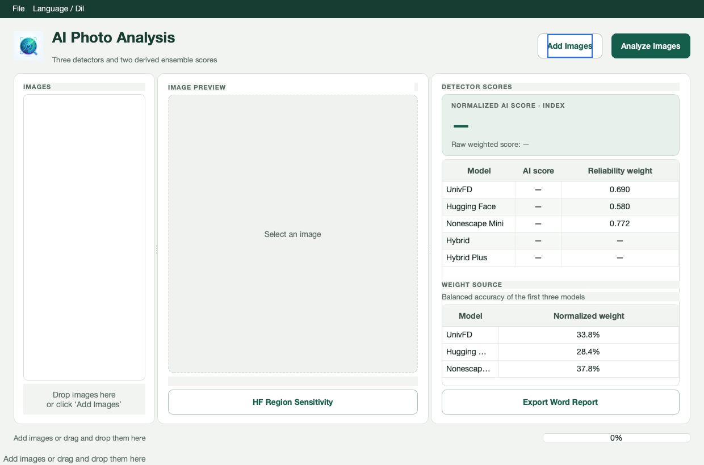
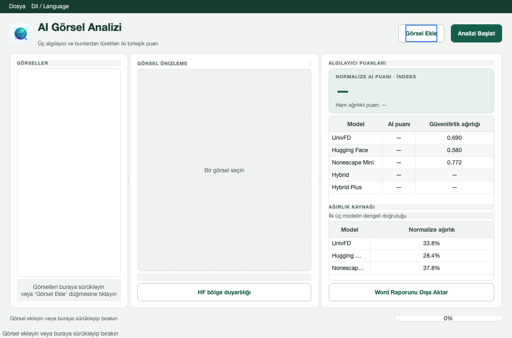

# AI Foto for macOS | AI Image Detector

[](#download)
[](#download)
[](#language-support)
[](LICENSE)

**AI Foto is a private, on-device AI image detector for Apple Silicon Macs.** It compares three model outputs, shows two derived ensemble scores, creates an optional region-sensitivity heatmap, and exports image score tables to Microsoft Word.

AI image detection is uncertain. Model scores are not calibrated probabilities and cannot prove whether an image is authentic. Hybrid and Hybrid Plus are derived from the same three base outputs, so they are not additional independent detectors.

## Screenshots

### English



### Türkçe



## Features

- Import JPEG, PNG, WebP, TIFF, or BMP images from the File menu or by drag and drop.
- Run three base image detectors locally: UnivFD, a Hugging Face ViT classifier, and Nonescape Mini.
- Compare the two derived scores, Hybrid and Hybrid Plus, beside the base model outputs.
- View the raw weighted mean and a separate normalized display index. The index changes display scale only; it does not recalibrate the models or change their predictions.
- Optionally generate an 8 × 8 HF occlusion-sensitivity map. Orange means covering a region lowered the model score; blue means it raised it.
- Export analyzed images, score tables, weighted score, index, and any generated sensitivity maps to a Word `.docx` file.
- Keep image analysis on the Mac. Model files download from their upstream hosts when they are not already cached.

## Download

Download the latest **AI Foto.dmg** from [GitHub Releases](https://github.com/serkanpaker/ai-foto/releases/latest). Open the disk image and drag **AI Foto.app** to **Applications**.

This build targets Apple Silicon and macOS 14 or later. It is ad-hoc signed and not notarized by Apple. macOS may ask you to confirm the first launch in Finder. A first run with an empty model cache needs internet access to download model files.

## Language support

Use **Language / Dil** in the menu bar to switch between English and Türkçe. The selection is saved on the Mac and restored at the next launch. The Word report follows the selected language.

## Build from source

Use Python 3.12 on an Apple Silicon Mac. Create a virtual environment and install the pinned dependencies:

```bash
python3.12 -m venv .venv
source .venv/bin/activate
python -m pip install -r requirements.txt
```

Build the app bundle and drag-to-Applications DMG:

```bash
pyinstaller --noconfirm --clean "AI Photo.spec"
./build_dmg.sh
```

Nonescape Mini weights are fetched from the upstream model host when first used. The 83 MB weight file is intentionally excluded from Git history.

## Model attribution

AI Foto adapts the [Lynote AI Image Detector](https://github.com/lynote-ai/ai-image-detector), an MIT-licensed project, for a native macOS desktop interface. Model authors and sources:

- **UnivFD / UniversalFakeDetect** — Utkarsh Ojha, Yuheng Li, Yong Jae Lee, *Towards Universal Fake Image Detectors That Generalize Across Generative Models*, CVPR 2023. [Paper](https://openaccess.thecvf.com/content/CVPR2023/html/Ojha_Towards_Universal_Fake_Image_Detectors_That_Generalize_Across_Generative_Models_CVPR_2023_paper.html) · [Official implementation](https://github.com/WisconsinAIVision/UniversalFakeDetect). The classifier weights are mirrored by [DeepSafe](https://huggingface.co/siddharthksah/deepsafe-weights); the base CLIP ViT-L/14 checkpoint is attributed to OpenAI.
- **Hugging Face image classifier** — [CapCheck `ai-image-detection`](https://huggingface.co/capcheck/ai-image-detection), which credits the Google ViT base model and [dima806's CIFAKE fine-tune](https://huggingface.co/dima806/ai_vs_real_image_detection). The model card lists Apache 2.0 and notes that performance can vary on newer generators and compressed images.
- **Nonescape Mini** — adapted from [e3ntity/Nonescape](https://github.com/e3ntity/nonescape), distributed under Apache 2.0. Its distilled weights are downloaded from the source project.
- **Hybrid and Hybrid Plus** — fixed weighted combinations calculated by this app from the three base detector scores. They do not load separate trained models.

See [THIRD_PARTY_NOTICES.md](THIRD_PARTY_NOTICES.md) for license and component details. The complete Python dependency versions are pinned in [`requirements.txt`](requirements.txt).

## License

AI Foto is distributed under the MIT License. See [`LICENSE`](LICENSE) and [`THIRD_PARTY_NOTICES.md`](THIRD_PARTY_NOTICES.md) for upstream code, model, and dependency attribution.

---

# AI Foto for macOS | Yapay Zekâ Görsel Algılayıcı

**AI Foto, Apple Silicon Mac’lerde yerel çalışan bir yapay zekâ görsel analiz uygulamasıdır.** Üç temel modelin puanlarını karşılaştırır, aynı çıktılardan türetilen iki birleşik puanı gösterir, isteğe bağlı bölge duyarlılık haritası oluşturur ve sonuçları Microsoft Word belgesine aktarır.

AI görsel algılama kesin sonuç vermez. Model skorları kalibre edilmiş olasılık değildir ve görselin gerçekliğini kanıtlamaz. Hybrid ve Hybrid Plus aynı üç temel modelin çıktılarından türetilir; ek bağımsız algılayıcılar değildir.

## Ekran görüntüleri

Uygulama İngilizce ve Türkçe arayüz sunar. Dil seçimi menü çubuğundaki **Language / Dil** menüsünden yapılır ve Mac’te saklanır. İndirme, özellikler ve atıflar için yukarıdaki bölümlere bakın.

## Özellikler

- JPEG, PNG, WebP, TIFF ve BMP görsellerini Dosya menüsünden ekleyin veya pencereye sürükleyip bırakın.
- UnivFD, Hugging Face ViT sınıflandırıcısı ve Nonescape Mini algılayıcılarını Mac üzerinde çalıştırın.
- Üç temel algılayıcının puanlarını ve aynı çıktılardan hesaplanan Hybrid ile Hybrid Plus puanlarını karşılaştırın.
- Ham ağırlıklı puanı ve ayrı normalize gösterge indeksini görüntüleyin. İndeks yalnızca gösterim ölçeğini değiştirir, model tahminlerini veya olasılık kalibrasyonunu değiştirmez.
- İsteğe bağlı 8 × 8 HF bölge duyarlılığı haritası oluşturun. Turuncu, bölge kapatıldığında model puanının düştüğünü; mavi yükseldiğini gösterir.
- Analiz edilen görselleri, puan tablolarını, ağırlıklı puanı, indeksi ve varsa duyarlılık haritalarını Word `.docx` dosyasına aktarın.
- Görsel analizini Mac üzerinde çalıştırın. Önbellekte bulunmayan model dosyaları ilk kullanımda kaynaklarından indirilir.

## İndirme

En son **AI Foto.dmg** dosyasını [GitHub Releases](https://github.com/serkanpaker/ai-foto/releases/latest) sayfasından indirin. Disk imajını açın ve **AI Foto.app** uygulamasını **Applications** klasörüne sürükleyin.

Bu sürüm Apple Silicon ve macOS 14 veya üstünü hedefler. Uygulama Apple tarafından imzalanıp noter onayından geçmemiştir; Finder ilk açılışta onay isteyebilir. Model önbelleği boşsa ilk kullanımda internet bağlantısı gerekir.

## Kaynak koddan derleme

Apple Silicon Mac ve Python 3.12 kullanın. Sanal ortam oluşturup sabitlenmiş paketleri yükleyin:

```bash
python3.12 -m venv .venv
source .venv/bin/activate
python -m pip install -r requirements.txt
```

Uygulama paketini ve sürükle-bırak DMG dosyasını oluşturun:

```bash
pyinstaller --noconfirm --clean "AI Photo.spec"
./build_dmg.sh
```

Nonescape Mini ağırlıkları ilk kullanımda kaynak model sunucusundan alınır. 83 MB ağırlık dosyası Git deposuna eklenmez.

## Model atıfları

AI Foto, MIT lisanslı [Lynote AI Image Detector](https://github.com/lynote-ai/ai-image-detector) kodunun bölümlerini macOS masaüstü uygulamasına uyarlar. UnivFD, Hugging Face algılayıcısı, Nonescape Mini ve bu modellerin lisansları için üstteki **Model attribution** ve [THIRD_PARTY_NOTICES.md](THIRD_PARTY_NOTICES.md) bölümlerine bakın.

## Lisans

AI Foto MIT Lisansı ile dağıtılır. Üçüncü taraf kod, model ve bağımlılık atıfları için [THIRD_PARTY_NOTICES.md](THIRD_PARTY_NOTICES.md) dosyasına bakın.
